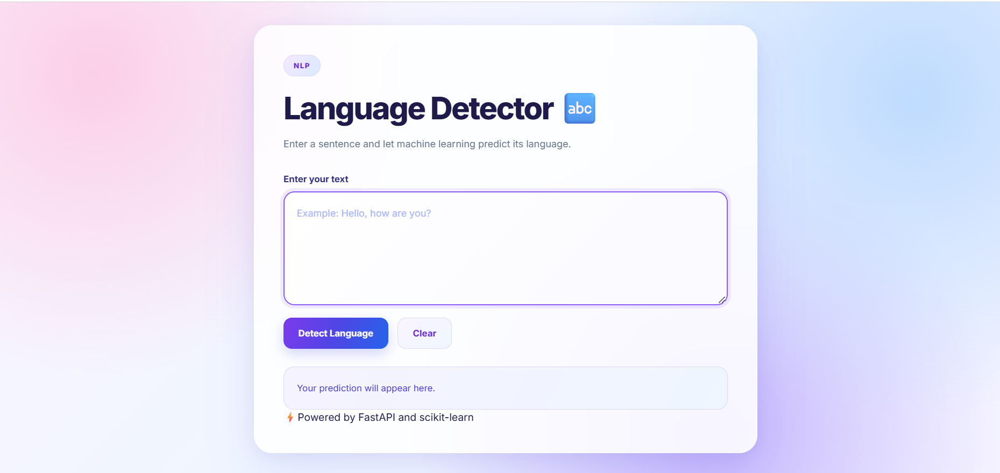

# 🌐 Language Detector

<p align="center">
  <strong>⚡ An AI-powered web application that identifies the language of text using Machine Learning.</strong>
</p>

<p align="center">
  
  
  
  
  
  
</p>

---


## 📌 Overview

**Language Detector** is a Machine Learning web application that predicts the language of a given text. It uses natural language processing techniques to transform text into numerical features and a trained classification model to identify the most likely language.

The application combines a Python-based Machine Learning pipeline with a FastAPI backend and a responsive frontend, providing an interactive way to explore language identification.


<p align="center">
  
</p>

---

## ✨ Key Features

- 🌍 **Automatic Language Identification** — Predicts the language of user-provided text.
- 🤖 **Machine Learning Model** — Uses Multinomial Naive Bayes for classification.
- 🔤 **Text Vectorization** — Converts text into numerical features using CountVectorizer.
- ⚡ **FastAPI Backend** — Provides a REST API for language predictions.
- 🎨 **Colorful User Interface** — Modern design with gradients, responsive layouts, and interactive elements.
- 🔄 **Real-Time Interaction** — Submit text and view prediction results without reloading the page.
- 🛡️ **Input Validation** — Handles empty text and inputs without recognized vocabulary features.
- 📚 **Interactive API Documentation** — Explore and test endpoints through Swagger UI.

## 🛠️ Tech Stack

| Technology | Purpose |
|---|---|
| Python | Core programming language |
| Pandas | Dataset loading and preprocessing |
| Scikit-learn | Machine Learning and text vectorization |
| CountVectorizer | Text-to-feature conversion |
| Multinomial Naive Bayes | Language classification |
| FastAPI | Backend and REST API |
| Uvicorn | ASGI development server |
| Pydantic | Request validation |
| Joblib | Saving and loading trained artifacts |
| HTML5 | Web page structure |
| CSS3 | Styling, gradients, animations, and responsive design |
| JavaScript | Frontend interactions and API requests |
| Jinja2 | HTML template rendering |

## 🧠 How It Works

1. **Input:** The user enters a sentence or paragraph in the web interface.
2. **Preprocessing:** The application prepares the text for prediction.
3. **Vectorization:** CountVectorizer transforms the text into numerical features using the vocabulary learned during training.
4. **Prediction:** The trained Multinomial Naive Bayes model predicts the language.
5. **Response:** FastAPI returns the predicted language as JSON.
6. **Display:** JavaScript presents the result on the webpage.

```text
             User Input
                 |
                 v
       HTML / CSS / JavaScript
                 |
                 v
            FastAPI API
                 |
                 v
         CountVectorizer
                 |
                 v
      Multinomial Naive Bayes
                 |
                 v
        Predicted Language
                 |
                 v
          Result on UI
```

## 📂 Project Structure

```text
language_detection/
│
├── app.py                      # FastAPI application
├── train_model.py               # Model training script
├── requirements.txt             # Python dependencies
│
├── data/
│   └── language.csv             # Language detection dataset
│
├── models/
│   ├── language_model.pkl       # Trained classifier
│   └── count_vectorizer.pkl     # Fitted text vectorizer
│
├── templates/
│   └── index.html               # Frontend HTML template
│
└── static/
    ├── style.css                # Frontend styling
    └── script.js                # Frontend interactions
```

## ⚙️ Installation and Setup

### 1. Clone the repository

```bash
git clone <YOUR_GITHUB_REPOSITORY_URL>
cd language_detection
```

Replace `<YOUR_GITHUB_REPOSITORY_URL>` with your actual repository URL.

### 2. Create a virtual environment

**Windows:**

```bash
python -m venv .venv
.venv\Scripts\activate
```

**macOS / Linux:**

```bash
python3 -m venv .venv
source .venv/bin/activate
```

### 3. Install dependencies

```bash
python -m pip install -r requirements.txt
```

### 4. Prepare the dataset

Place your dataset at:

```text
data/language.csv
```

The CSV file should contain these columns:

| Column | Description |
|---|---|
| `Text` | Input text sample |
| `language` | Corresponding language label |

### 5. Train the Machine Learning model

```bash
python train_model.py
```

This script trains the classifier and saves the model artifacts in the `models/` directory.

**Note:** Run training successfully before starting the application. The saved model files must exist at the expected paths.

### 6. Start the FastAPI server

```bash
uvicorn app:app --reload
```

## 🌐 Access the Application

After the server starts, open these URLs in your browser:

| Resource | URL |
|---|---|
| Web Application | http://127.0.0.1:8000/ |
| Swagger API Documentation | http://127.0.0.1:8000/docs |
| ReDoc API Documentation | http://127.0.0.1:8000/redoc |
| Health Check | http://127.0.0.1:8000/health |

## 🔌 API Documentation

### Predict Language

**Endpoint:** `POST /predict`

**Request Body:**

```json
{
  "text": "Hello, how are you?"
}
```

**Example Response:**

```json
{
  "input_text": "Hello, how are you?",
  "predicted_language": "English"
}
```

The predicted label depends on the classes and training data in your dataset.

### Health Check

**Endpoint:** `GET /health`

**Example Response:**

```json
{
  "status": "healthy"
}
```

## 📊 Model Details

| Component | Description |
|---|---|
| Problem Type | Multiclass text classification |
| Feature Extraction | CountVectorizer |
| Classification Algorithm | Multinomial Naive Bayes |
| Training Data | `data/language.csv` |
| Model Serialization | Joblib |
| Evaluation | Accuracy on a held-out test split |

The model learns patterns from labeled text samples. Prediction quality depends on dataset coverage, class balance, text quality, and how closely new inputs resemble the training data.


## 🔐 Best Practices

- Keep the training dataset and model artifacts organized.
- Do not commit virtual environments or sensitive credentials.
- Validate incoming text before processing it.
- Evaluate the model on unseen data before reporting performance.
- Keep dependencies documented in `requirements.txt`.

## 🤝 Contributing

Contributions, suggestions, and bug reports are welcome.

1. Fork the repository.
2. Create a feature branch.
3. Commit your changes.
4. Open a pull request describing your improvements.

## 📄 License

This project can be distributed under the MIT License. Before adding an MIT license badge, include a `LICENSE` file containing the appropriate license text.

## 👨‍💻 Author

**Milan**


---

<p align="center">
  🌐 <strong>Language Detector</strong>
  <br>
  Built with Python, Machine Learning, and FastAPI. ⚡
</p>